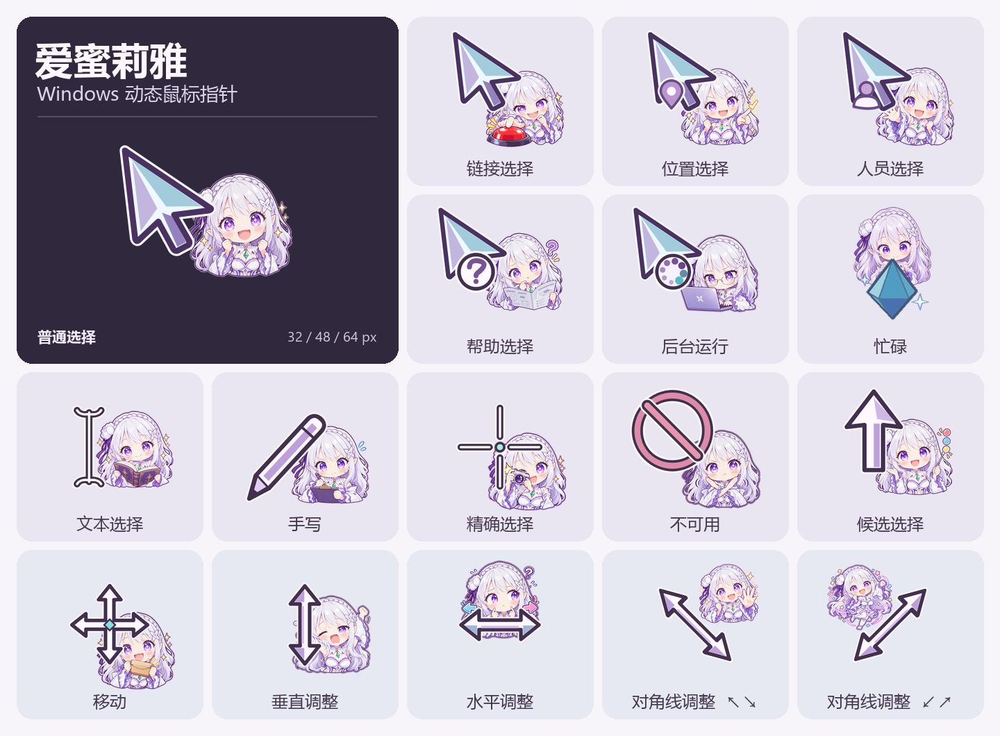

# 爱蜜莉雅 Windows 动态鼠标指针

这套指针覆盖 Windows 的 17 个鼠标状态，每枚都包含 32、48 和 64 像素三种尺寸。普通选择里的爱蜜莉雅从冰晶箭尾探出，停在原地眨眼。

[](assets/preview/emilia-cursors.webp)

[下载安装包](Emilia-Complete.zip) · [播放高清动图](assets/preview/emilia-cursors.webp)

## 安装

1. 完整解压安装包，保持 `右键安装.inf` 与 `Cursors` 文件夹位于同一层。从仓库直接安装时，打开 `Emilia-Complete` 文件夹即可。
2. 右键单击 `右键安装.inf`，选择「安装」。Windows 11 上可先点「显示更多选项」。
3. 按 `Win + R`，输入 `main.cpl`，在「指针」选项卡选择「爱蜜莉雅」并点击「应用」。恢复时，在同一处选回原方案。

## 查看实际尺寸

分组图里，浅色底展示 2 倍放大效果，深色底展示 64 像素原图。

[选择指针](assets/preview/details/selection.png) · [状态与工具](assets/preview/details/tools.png) · [移动与调整](assets/preview/details/resize.png)

## 素材与打包

角色图取自爱蜜莉雅同人表情包。本项目使用的闭眼帧和忙碌状态原画保存在 [art](art/) 中。[表情包素材版本](https://github.com/just1cez/emilia-meme-pack/tree/1f7a969d1d8d06cceaec6d46cdcf0f94354f5bcb/memes)

可安装文件位于 [Emilia-Complete](Emilia-Complete/)。修改成品指针后，在仓库根目录运行以下 PowerShell 命令即可重新打包：

```powershell
Compress-Archive -Path '.\Emilia-Complete\*' -DestinationPath '.\Emilia-Complete.zip' -Force
```
